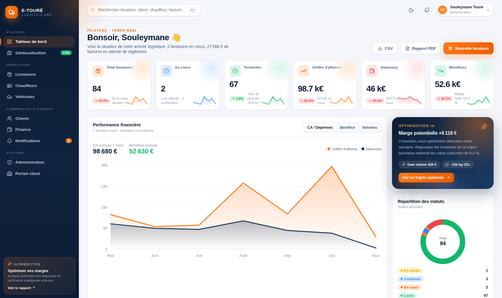
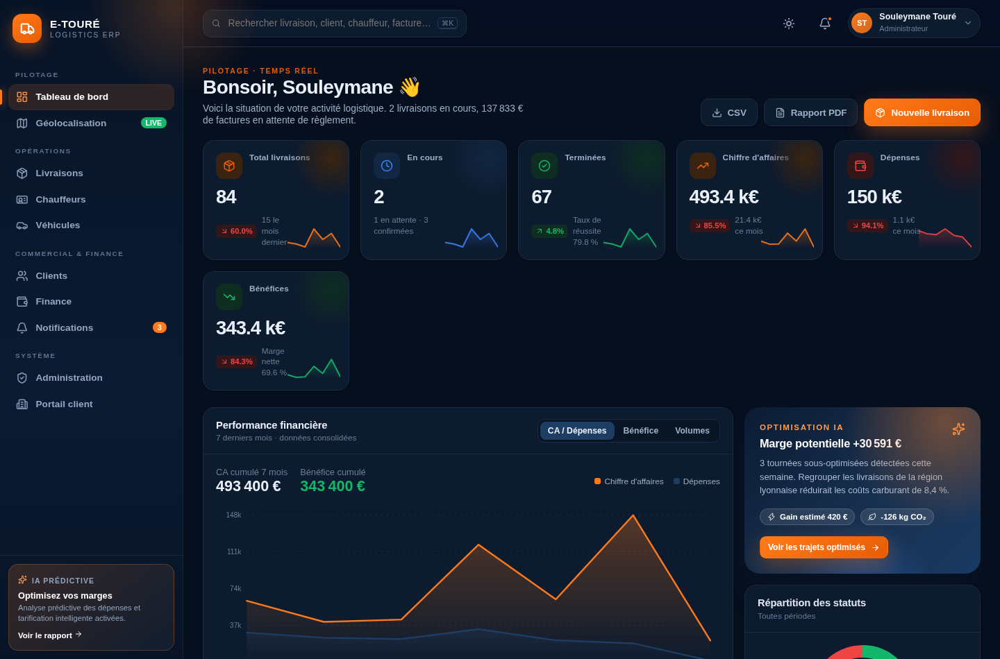
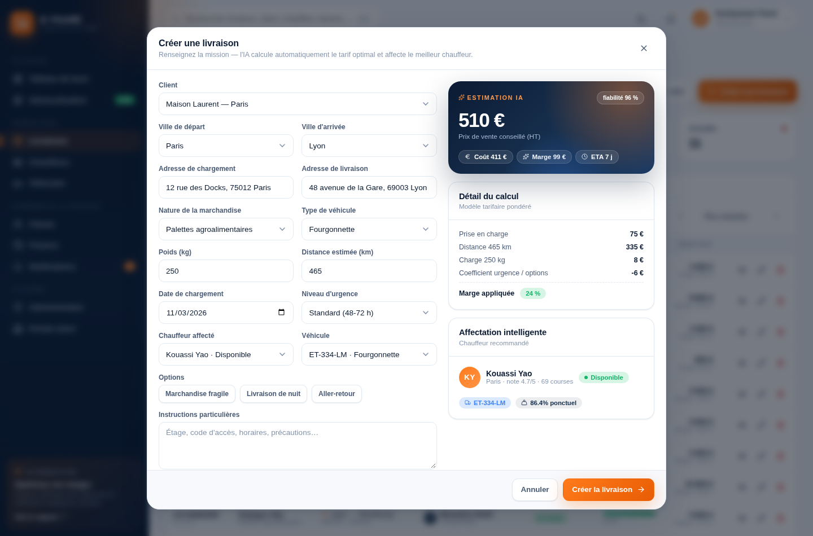
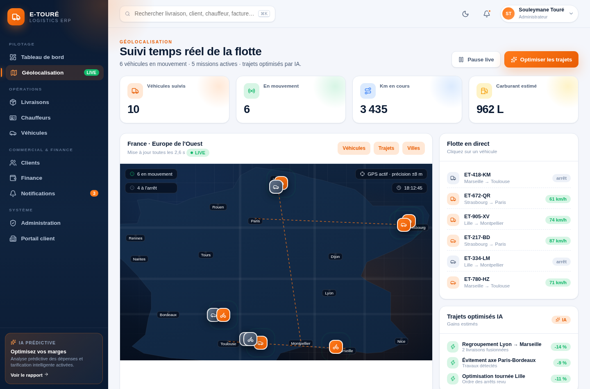
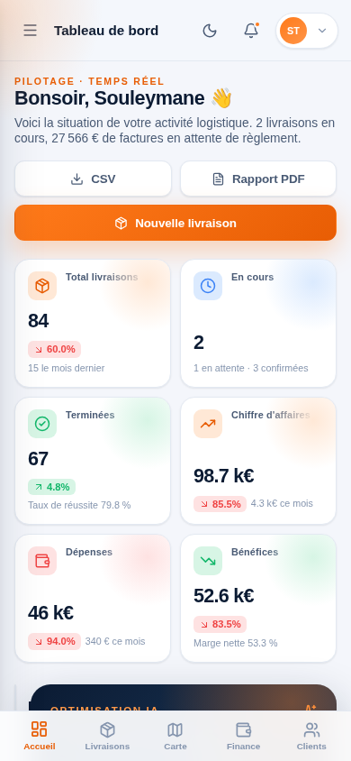
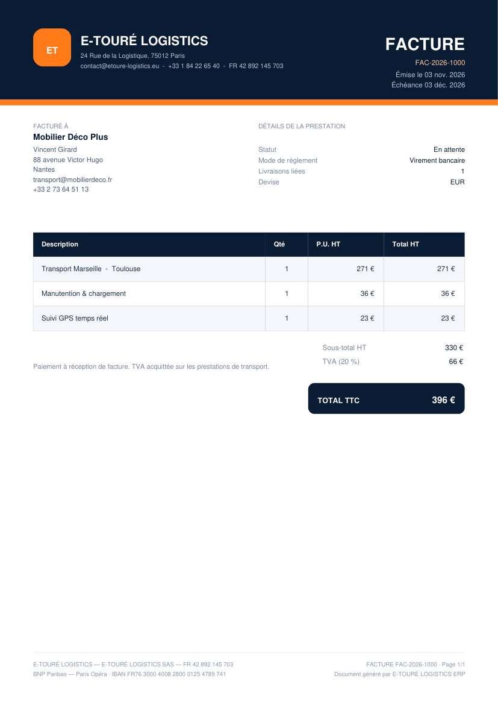

# E-TOURÉ LOGISTICS ERP

Application SaaS de gestion logistique — transport, livraison et déménagement.
**React 19 + Vite**, PWA installable, mode sombre, IA d'estimation et de prévision, PDF/Excel natifs.

---

## 1. Démarrer en 30 secondes

```bash
cd etoure-logistics-erp
npm install
npm run dev        # http://localhost:5173
npm run build      # build de production dans /dist
npm run preview    # prévisualiser le build
```

**Identifiants de démonstration**

| Rôle | E-mail | Mot de passe |
|---|---|---|
| Administrateur | admin@etoure-logistics.eu | `demo1234` |
| Manager | manager@etoure-logistics.eu | `demo1234` |
| Exploitant | dispatcher@etoure-logistics.eu | `demo1234` |
| Comptable | compta@etoure-logistics.eu | `demo1234` |
| Portail client | client@maisonlaurent.fr | `demo1234` |

> Le bouton **« Accès démo instantané »** ouvre l'espace du rôle sélectionné sans saisie.

### Aperçus

| Tableau de bord (desktop) | Mode sombre |
|---|---|
|  |  |

| Estimation IA à la création d'une livraison | Géolocalisation temps réel |
|---|---|
|  |  |

| Mobile (390 px) | Facture PDF générée |
|---|---|
|  |  |

---

## 2. Fonctionnalités livrées

### Tableau de bord
- KPI temps réel : total livraisons, en cours, terminées, CA, dépenses, bénéfices
- Graphiques animés maison en SVG (aires, barres, donut, heatmap, jauge, prévision)
- Comparaison mensuelle, panier moyen, marge nette, ponctualité
- Bloc « Optimisation IA », alertes de conformité, top clients / top chauffeurs
- Export **CSV** et **rapport PDF** de synthèse

### Livraisons
- CRUD complet, 5 statuts (en attente, confirmée, en cours, livrée, annulée)
- **Estimation IA du prix** en direct (distance, poids, véhicule, urgence, fragile, nuit, aller-retour) avec détail du calcul et indice de fiabilité
- **Affectation automatique du chauffeur** : score = disponibilité + note + zone + charge en cours
- Fiche détail : adresses, chauffeur/véhicule, frise de suivi, facturation et marge
- Filtres avancés (statut, chauffeur, véhicule, tri), export Excel/CSV

### Clients
- CRUD, recherche avancée multi-critères (ville, type, statut, CA minimum)
- Historique complet des commandes par client, synthèse commerciale, panier moyen
- Export Excel / CSV du répertoire

### Chauffeurs
- Profils complets (permis, visite médicale, contact d'urgence, zone)
- Documents administratifs avec compte à rebours d'expiration
- Performances : courses réalisées, ponctualité, CA généré, km, notation ⭐
- Badges de conformité, export Excel de l'équipe

### Véhicules
- Camions, fourgonnettes, motos (capacités, carburant, CO₂, GPS)
- Assurance + visite technique + maintenance préventive (prochain seuil km)
- **Alertes d'expiration** classées par urgence, mise en maintenance en 1 clic
- Répartition de la flotte (donut) et export Excel

### Finance
- **Factures et devis PDF** professionnels (en-tête, TVA 20 %, IBAN, mentions légales)
- Dépenses (saisie, catégories, fournisseurs, moyens de paiement), entrées d'argent
- Relances d'impayés, marquage « payée », échéances en rouge si dépassées
- **Rapport financier PDF** + **export Excel 3 feuilles**
- **Analyse prédictive des dépenses** (régression linéaire, R², horizon 3 mois)

### Géolocalisation
- Carte vectorielle de France (contour + réseau), marqueurs véhicules animés
- Simulation **temps réel** de la progression des missions (pause/reprise)
- Trajets, historique des déplacements, suggestion de tournées optimisées par IA

### Notifications
- Multi-canaux : e-mail, SMS, WhatsApp, push
- Compteur non-lus, filtres par canal/type, marquage lu
- Compositeur d'envoi manuel + règles automatiques activables

### Portail client
- Espace sécurisé par rôle (session dédiée)
- Commandes, suivi temps réel, téléchargement des factures PDF, interlocuteur dédié

### Administration
- Utilisateurs (CRUD, rôles, suspension, rattachement client)
- Rôles & permissions (5 rôles, matrice de droits appliquée à la navigation)
- Journal des activités horodaté (audit)
- Sauvegarde complète (Excel + snapshot JSON), santé du système, réinitialisation
- Paramètres société utilisés sur les PDF, objectifs de performance

### Premium & PWA
- Mode sombre complet (persistant)
- Installation sur mobile/desktop (manifest + service worker, cache hors-ligne)
- Recherche globale ⌘K / Ctrl+K, toasts, animations discrètes, `prefers-reduced-motion`
- Responsive testé 390 px / 834 px / 1440 px

---

## 3. Architecture

```
etoure-logistics-erp/
├─ db/
│  ├─ schema.postgres.sql      # PostgreSQL 16 : 22 tables, 4 vues, 25 index (recommandé)
│  ├─ schema.mysql.sql         # MySQL 8 : 22 tables, 4 vues, FULLTEXT FR
│  └─ README-DATABASE.md       # comparatif et recommandation détaillée
├─ public/
│  ├─ manifest.webmanifest      # PWA (icônes, raccourcis, standalone)
│  ├─ sw.js                     # service worker (cache app shell)
│  └─ icons/                    # 192 / 512 / maskable / apple-touch
├─ src/
│  ├─ main.jsx                  # bootstrap + enregistrement SW
│  ├─ App.jsx                   # routes protégées, lazy-loading par module
│  ├─ styles.css                # design system (tokens, composants, responsive, dark)
│  ├─ components/
│  │  ├─ Shell.jsx              # sidebar, topbar, recherche globale, nav mobile
│  │  ├─ ui.jsx                 # KPI, badges, modales, tableaux, pagination…
│  │  └─ Charts.jsx             # graphiques SVG (aires, barres, donut, heatmap, jauge)
│  ├─ store/
│  │  ├─ StoreContext.jsx       # état global (reducer) + persistance localStorage
│  │  └─ AuthContext.jsx        # session, rôles, JWT simulé, permissions
│  ├─ data/
│  │  ├─ seed.js                # jeu de données réaliste (clients, flotte, 84 livraisons…)
│  │  └─ analytics.js           # KPI, séries mensuelles, prévisions, heatmap, alertes
│  ├─ lib/helpers.js            # formats FR, IA tarifaire, PDF, Excel/CSV, régression
│  └─ pages/                    # Login, Dashboard, Deliveries, Clients, Drivers,
│                               # Vehicles, Finance, MapLive, Notifications, Admin, Portal
```

### Modèle de données (entités)
`clients` · `drivers` · `vehicles` · `deliveries` · `invoices` · `quotes` · `expenses` · `notifications` · `users` · `activityLog` · `settings`

### Formule d'estimation IA (`lib/helpers.js`)
```
coût  = (base_véhicule + km × tarif_km + kg × tarif_kg)
        × coefficient_urgence × options (fragile, nuit, aller-retour)
        × (1 − 0.08 × taux_de_remplissage)
prix  = coût × (1 + marge 24 %)
ETA   = distance / vitesse_moyenne(véhicule) + tampon urgence
```

---

## 4. Passer en production (backend réel)

Le frontend est prêt pour une API REST ; il suffit de remplacer la couche `store` par des appels HTTP :

| Besoin | Recommandation |
|---|---|
| API REST | Node.js (Express/NestJS) **ou** Laravel (MVC), endpoints `/api/deliveries`, `/api/clients`… |
| Base de données | **PostgreSQL 16 recommandé** (ou MySQL 8) — schémas prêts dans `db/` · voir `db/README-DATABASE.md` |
| Auth | JWT signé (HS256/RS256) + refresh token, 2FA TOTP pour les admins |
| PDF | conserver le rendu client (jsPDF) ou générer côté serveur (Puppeteer / DomPDF) |
| E-mail / SMS / WhatsApp | SendGrid · Twilio · WhatsApp Business API |
| GPS | API cartographique (Mapbox / Leaflet + OSM) + position des boîtiers télématiques |
| Fichiers | S3 / MinIO pour les documents chauffeurs et preuves de livraison |

Points d'ancrage dans le code :
- `src/store/StoreContext.jsx` → remplacer `dispatch` par des mutations serveur (React Query / SWR).
- `src/store/AuthContext.jsx` → `makeToken()` à remplacer par le jeton renvoyé par l'API.
- `src/lib/helpers.js` → centralise formats, IA et génération de documents.

---

## 5. Notes techniques

- Bundles lourds (`jsPDF`, `XLSX`) chargés **à la demande** : le premier écran reste léger.
- Aucune police externe (empilement système) → pas de requête réseau, rendu instantané.
- Graphiques 100 % SVG maison : zéro dépendance de charting, thème clair/sombre automatique.
- Données persistées dans `localStorage` (`etoure-erp-state-v1`) ; la réinitialisation est dans **Administration → Sauvegarde & système**.
- Accessibilité : navigation clavier, `aria-label`, focus visibles, contrastes AA, `prefers-reduced-motion`.

© 2026 E-TOURÉ LOGISTICS SAS — démonstration produit.
